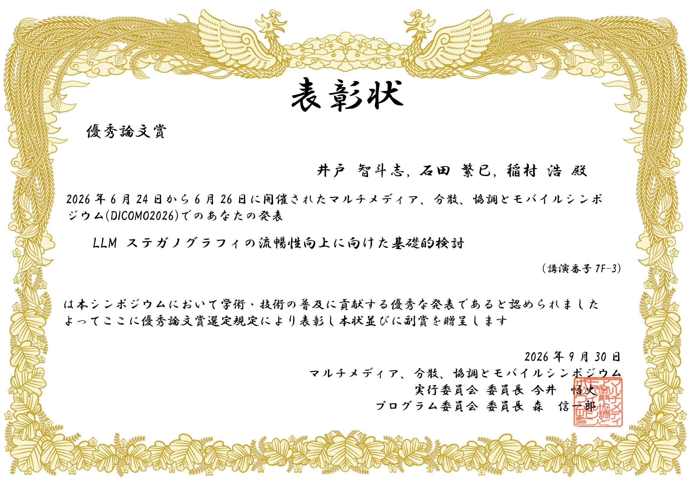

M2 井戸 智斗志さんらの論文「LLMステガノグラフィの流暢性向上に向けた基礎的検討」が、[DICOMO2026の表彰情報](https://dicomo.org/commendation/)に掲載されている優秀論文賞を受賞しました。
おめでとうございます！

## 論文情報

- 井戸 智斗志, 石田 繁巳, 稲村 浩, 「LLMステガノグラフィの流暢性向上に向けた基礎的検討」, 情報処理学会マルチメディア、分散、協調とモバイルシンポジウム（DICOMO2026）, 7F-3, pp.1969-1976, Jun 2026.

